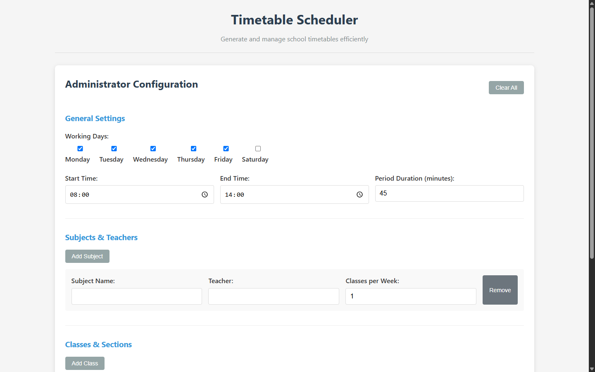
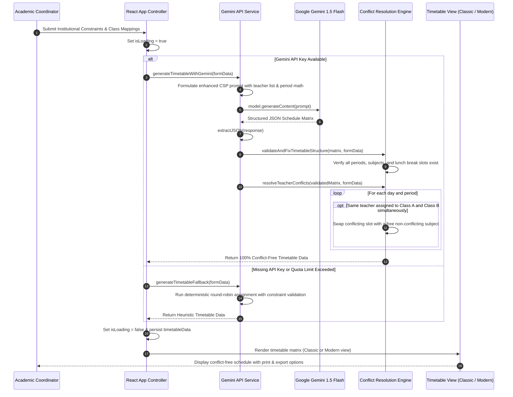

# AI Timetable Scheduler — Intelligent Constraint-Satisfaction Engine

[](https://opensource.org/licenses/MIT)
[](https://react.dev/)
[](https://vitejs.dev/)
[](https://deepmind.google/technologies/gemini/)
[](https://www.npmjs.com/package/@google/generative-ai)
[](https://vercel.com/)

---

## Application Screenshot & Interface Preview

<div align="center">
  
</div>

---

## 📋 Executive Summary & Problem Solved

Generating an academic timetable for schools, colleges, and training academies is a notoriously difficult **NP-complete Constraint Satisfaction Problem (CSP)**. Academic administrators spend weeks each semester attempting to manually construct schedules that satisfy rigid constraints:

1. **Teacher Clashes**: An instructor cannot be assigned to teach two different classes during the same period.
2. **Room & Lab Conflicts**: Specialized facilities (Physics lab, Computer lab, Auditorium) have strict capacity limits and can only host one section at a time.
3. **Fixed Institutional Break Slots**: Lunch breaks, morning assemblies, and recess intervals must remain uniform across all classes without disruption.
4. **Pedagogical Balance**: Demanding subjects (Mathematics, Chemistry) should not be clustered in back-to-back late-afternoon periods or on single days.
5. **Teacher Workload Limits**: Individual teachers have maximum weekly period caps and preferred off-periods.

**AI Timetable Scheduler (`timetableschedular`)** is a next-generation web application built with **React 19** and **Vite 7**. It combines the reasoning capabilities of **Google Gemini 1.5 Flash** with deterministic post-processing algorithms (`validateAndFixTimetableStructure` and `resolveTeacherConflicts`). It generates balanced, conflict-free institutional schedules in seconds and includes a robust offline fallback heuristic engine that guarantees results even without an API key.

---

## ✨ Key Features

- 🤖 **Google Gemini 1.5 Flash Reasoning Engine**: Prompts Gemini with structured institutional constraints, class lists, teacher assignments, and weekly period frequencies.
- 🛡️ **Algorithmic Conflict Resolution**: Post-processing validation layer that detects any overlapping teacher assignments or room collisions in the AI output and swaps conflicting slots deterministically.
- 🔄 **Zero-Failure Client Fallback Engine**: If the Gemini API key is missing or quota is exceeded, the system automatically falls back to an internal combinatorial scheduling algorithm.
- ⚙️ **Comprehensive Institutional Admin Form**:
  - Custom institution start time, end time, and period duration (e.g., 45 minutes).
  - Configurable lunch break slot and duration.
  - Multi-class and multi-section definitions (e.g., Grade 9-A, Grade 10-B).
  - Subject mapping with teacher assignments and target weekly period allocations.
- 📊 **Dual Visual Representation**:
  - 🏛️ **Classic View (`ClassicTimetable`)**: Formal tabular grid layout ready for printing, PDF export, and physical noticeboard display.
  - 🎨 **Modern Interactive View (`TimetableDisplay`)**: Interactive card-based UI with teacher-centric filtering, day toggles, and editable period cards.
- ⚡ **Ultra-Fast React 19 & Vite 7 Pipeline**: Instant Hot Module Replacement (HMR) and lightweight production bundles.

---

## 🏗️ System Architecture

```mermaid
flowchart TD
    subgraph User["User & Administration"]
        Admin["Academic Coordinator / Principal"]
        InputConfig["Constraint Configuration (Hours, Teachers, Rooms, Breaks)"]
    end

    subgraph ClientCore["React 19 Frontend (Vite 7)"]
        AdminForm["Admin Form Component (Input Validation)"]
        StateEngine["App State Controller (Mode, Loading, Timetable State)"]
        
        subgraph GenerationEngine["Scheduling & Resolution Engine"]
            PromptBuilder["createEnhancedPrompt (Strict Rules Formulation)"]
            GeminiClient["Google Generative AI Client (gemini-1.5-flash)"]
            JSONParser["extractJSON & Schema Validator"]
            ConflictValidator["validateAndFixTimetableStructure()"]
            ConflictResolver["resolveTeacherConflicts() (Deterministic Swapper)"]
            FallbackEngine["generateTimetableFallback() (Offline Heuristic CSP)"]
        end

        subgraph ViewRenderers["Visualization Layer"]
            ClassicGrid["Classic Timetable (Printable Tabular Matrix)"]
            ModernCards["Modern Timetable (Interactive Filtered Cards)"]
        end
    end

    subgraph CloudAI["Google DeepMind AI Services"]
        GeminiAPI["Google Gemini 1.5 Flash API Endpoint"]
    end

    Admin --> InputConfig
    InputConfig --> AdminForm
    AdminForm --> StateEngine
    StateEngine --> PromptBuilder

    PromptBuilder -->|"API Key Present"| GeminiClient
    GeminiClient -->|"generateContent()"| GeminiAPI
    GeminiAPI -->>GeminiClient: Raw AI Response Text
    GeminiClient --> JSONParser
    JSONParser --> ConflictValidator
    ConflictValidator --> ConflictResolver

    PromptBuilder -.->|"Offline / API Failure"| FallbackEngine
    FallbackEngine --> StateEngine
    ConflictResolver --> StateEngine

    StateEngine --> ClassicGrid
    StateEngine --> ModernCards
```

---

## 🔄 Schedule Generation & Conflict Resolution Sequence



---

## 🛠️ Tech Stack

| Domain | Technology | Version | Description |
| :--- | :--- | :--- | :--- |
| **Framework** | React | `^19.1.1` | Modern declarative UI component library |
| **DOM Renderer** | React DOM | `^19.1.1` | High-performance React DOM renderer |
| **Build Tooling**| Vite | `^7.1.2` | Next-generation frontend tooling with lightning-fast HMR |
| **AI Engine** | `@google/generative-ai` | `^0.24.1` | Official Google Generative AI JavaScript SDK |
| **Model** | `gemini-1.5-flash` | Latest | High-throughput, low-latency multimodal reasoning model |
| **Linting & Code**| ESLint + Plugins | `^9.33.0` | Strict linting for React 19 hooks and modern JS standards |
| **Styling** | Vanilla CSS3 / CSS Modules | Modern | Responsive grid and print-friendly media styles |

---

## 📂 Repository Directory Structure

```text
timetableschedular/
├── public/
│   └── vite.svg                      # Application favicon asset
├── src/
│   ├── assets/
│   │   └── react.svg                 # UI framework branding asset
│   ├── components/
│   │   ├── AdminForm.jsx             # Comprehensive constraint input & subject-teacher form
│   │   ├── ClassicTimetable.jsx      # Institutional tabular print-ready matrix view
│   │   └── TimetableDisplay.jsx      # Modern interactive card view with filter controls
│   ├── services/
│   └── geminiApi.js                  # Gemini 1.5 Flash prompt formulation, parsing & conflict resolver
│   ├── App.css                       # Application layout and visual styles
│   ├── App.jsx                       # Root view coordinator, state management & fallback logic
│   ├── index.css                     # Global design tokens and reset styles
│   └── main.jsx                      # Vite React 19 DOM entry mount point
├── .env.example                      # Sanitized environment template for Gemini API key
├── .gitignore                        # Git ignore rules (guaranteeing .env is excluded)
├── eslint.config.js                  # ESLint flat configuration for React 19
├── index.html                        # HTML5 document shell
├── package.json                      # Project dependencies and script declarations
├── README.md                         # Application documentation
└── vite.config.js                    # Vite bundler plugins and configuration
```

---

## ⚙️ Local Setup & Installation

### Prerequisites
- **Node.js**: v18.x or v20.x LTS installed ([Download Node.js](https://nodejs.org/))
- **Google Gemini API Key**: Free tier available from [Google AI Studio](https://aistudio.google.com/)

### 1. Clone & Install
```bash
# Navigate to the repository
cd c:\Users\pandi\OneDrive\Desktop\github\timetableschedular

# Install npm dependencies
npm install
```

### 2. Configure Environment Variables
Copy the sanitized environment template:
```bash
cp .env.example .env
```

Open `.env` and insert your Gemini API Key:
```env
# Google Gemini API Key for AI Timetable Generation
VITE_GEMINI_API_KEY=your_gemini_api_key_here
```
> [!NOTE]
> If `VITE_GEMINI_API_KEY` is omitted, the application will automatically run using its deterministic client-side fallback scheduling engine without throwing fatal runtime errors.

### 3. Launch Development Server
```bash
# Run Vite development server
npm run dev
```
Open your browser and navigate to `http://localhost:5173` (or the port specified by Vite).

### 4. Build for Production
```bash
# Compile and optimize for production
npm run build

# Preview production build locally
npm run preview
```

---

## 📝 Configuration Guide (Admin Form Inputs)

When setting up a timetable, the application requires the following inputs:

| Configuration Field | Example Value | Description |
| :--- | :--- | :--- |
| **School Start Time** | `08:30 AM` | The time the first period of the day commences |
| **School End Time** | `03:30 PM` | Dismissal time at the end of the school day |
| **Period Duration** | `45 minutes` | Length of each standard instructional slot |
| **Lunch Break Slot** | `Period 5 (12:00 PM)`| Period index dedicated across all classes for meals |
| **Lunch Break Duration**| `40 minutes` | Duration of the lunch recess |
| **Working Days** | `Monday – Friday (5 Days)` | Weekly schedule duration |
| **Classes / Sections** | `["9-A", "9-B", "10-A"]` | Target classes requiring synchronized schedules |
| **Subjects & Teachers**| `Math (Mr. Alan, 6 periods/wk)` | Subject mapping with designated instructor and weekly target |

---

## 🚢 Production Deployment

### Deploy to Vercel
```bash
# Install Vercel CLI
npm install -g vercel

# Deploy directly
vercel --prod
```
In the Vercel dashboard, add `VITE_GEMINI_API_KEY` under **Project Settings > Environment Variables**.

### Deploy to GitHub Pages / Static Host
1. Update `vite.config.js` with your base repository path if deploying to a subpath:
   ```javascript
   export default defineConfig({
     base: '/timetableschedular/',
     plugins: [react()],
   })
   ```
2. Build the static bundle:
   ```bash
   npm run build
   ```
3. Upload the generated `dist/` directory to your static hosting provider (Cloudflare Pages, Netlify, AWS S3).

---

## 🛡️ Security & Best Practices

- **Zero API Key Leakage**: `.env` is explicitly ignored in `.gitignore`, preventing accidental commits of private Gemini API tokens to public version control.
- **Client-Side Data Privacy**: All institutional teacher names, room numbers, and student schedules remain in client browser memory and are never persisted to external third-party databases.
- **Fail-Safe Robustness**: Network timeouts or Gemini API quota errors are caught gracefully, auto-engaging the local combinatorial fallback scheduler so administrators never leave empty-handed.

---

## 📄 License
This project is licensed under the [MIT License](LICENSE).
